<h1><a href="./README.md">Back to main</a></h1>
<h1>Using the app</h1>
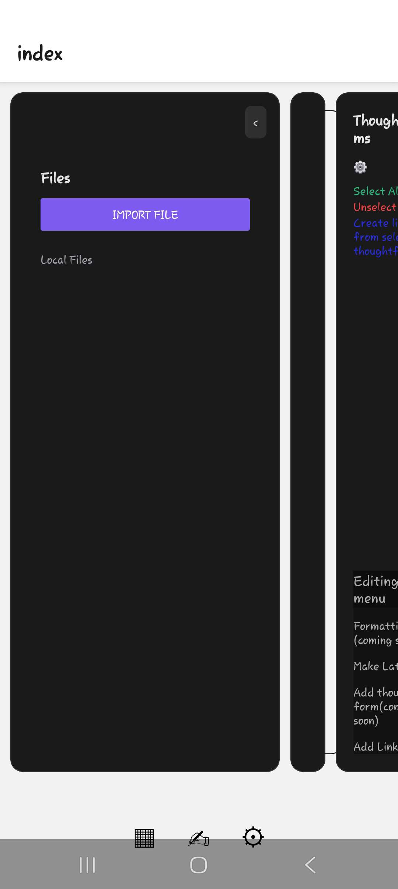

This is the home page which you will see when first opening the app

The first thing you should do is click the settings button which is the button at the bottom of the screen that looks like a cog or wheel

That should take you to this page

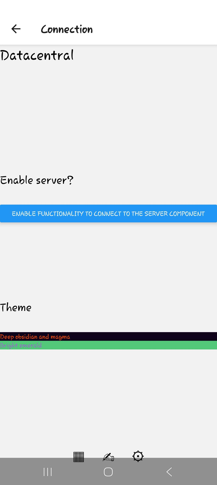

With magma theme

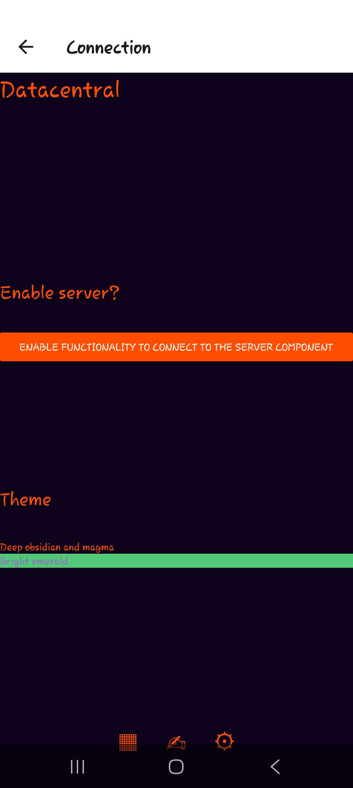

With emerald theme

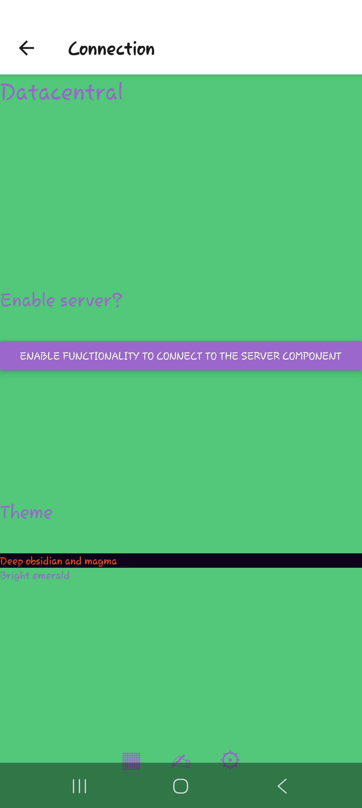

I would strongly reccomend clicking a theme from "Deep obisidan and magma" or "Bright emerald" by clicking on the theme you wish to pick

Your changes will be initialised when you refresh the page by clicking on the settings button again or when you return to the home page

You can now return to the home page by clicking on the editor button which is the button that resembles a hand holding a pen at the bottom of the screen

This is what the home page will now look like:

Magma

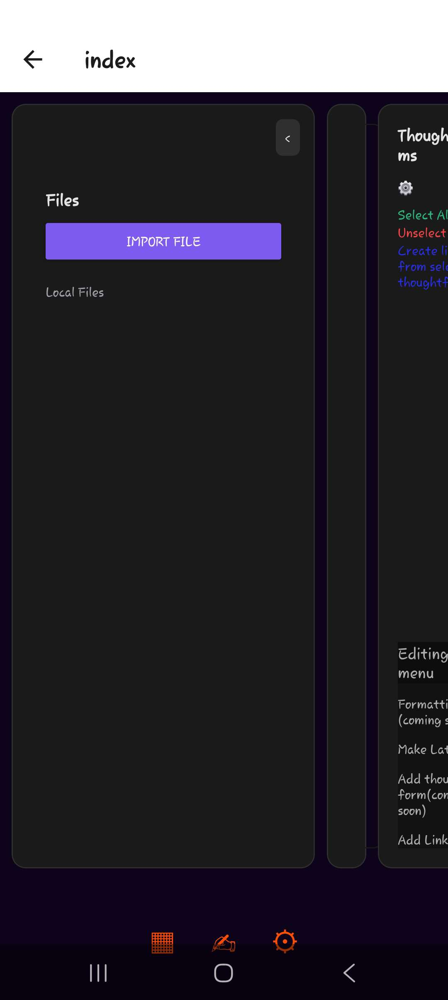

Emerald

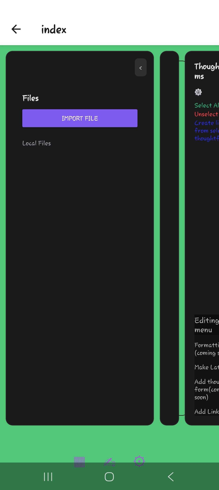

You can upload files either by clicking the "upload" button and uploading files from your phone, or waiting and the "Server directory" files menu will become populated with the files from the file server on the server component, clicking on one of these files will download it into your local files on the app (as well as uploading a file from your phone) 

You can click on a local file to interact with it

The screen below is a demonstration of this with an example file

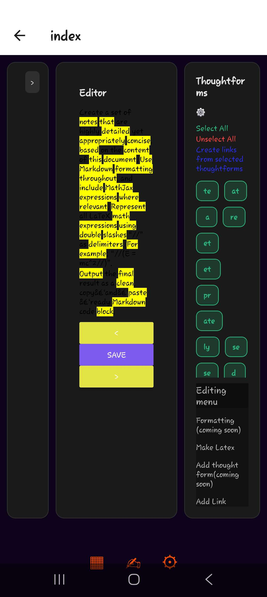

The file loads in chunks. Everything you see on this page is one chunk. You can navigate the chunks using the arrows. You can also edit chunks freely however currently saving an edited chunk results in it being saved as it's own file (in the local files).

You will see on the side a menu saying "thoughtforms". Thoughtforms in the text files are symbols of sorts <a href="https://github.com/datacentral-creator/datacentral-creator.github.io/blob/main/Datacentral_implementations/tagger.md">(You can read more about this here)</a>. They are the words the text is based around. The thoughtforms in the document you are editing are highlighted yellow by default. You can also filter thoughtforms by pressing the settings button in the thoughtform menu to filter the minimum length you will allow a thoughtform to be as shown below. 

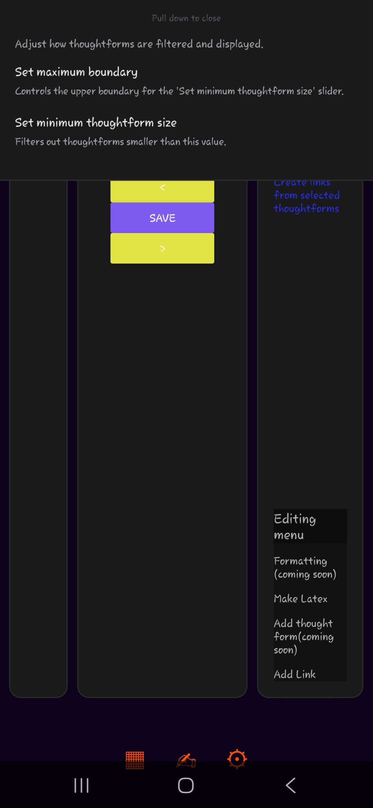

Thoughtforms are also useful because of the button "create links from selected thoughtforms". All thoughtforms are selected by default but you can unselect thoughtforms that aren't useful or deselect all thoughtforms and just select the ones you want then turn these thoughtforms into links (you can also select text manually and turn it into a link). 

If you click the grid icon on the bottom left it will take you to a projects menu

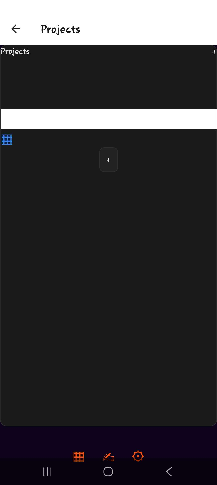

Projects are collections of links, files and other projects.

This is what it looks like once you've clicked on a project

References menu

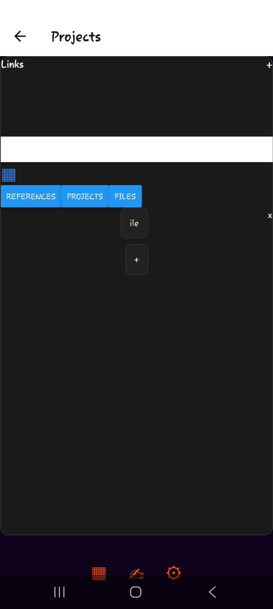

Projects menu(for nested projects)

Files menu

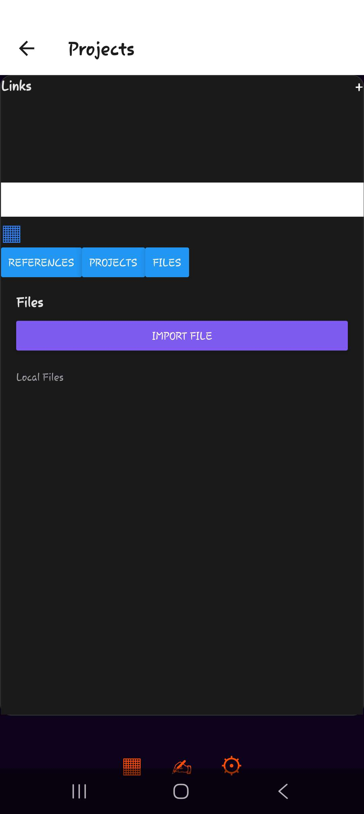

On the files menu if the file is an image and you click on it it opens the image

You can create projects and add subprojects and references using the "+" button 

The grid on the top left is to navigate between viewing the results as a list or a grid and the white search bar at the top allows you to search the results

